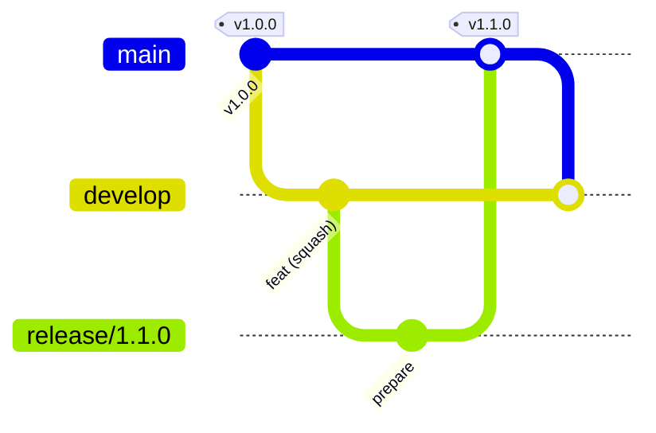

# github-workflows

Reusable GitHub Actions workflows and actions:

- [Gitflow](#gitflow): start a release, check it, tag it on merge into `main`, merge `main` back into `develop`. And a [script](#setting-up-a-repository) that sets a repository up for it.
- [PR screenshots](#pr-screenshots): screenshots of a pull request's pages, posted as one comment that updates in place.
- [Google Analytics](#google-analytics): add Google Analytics to every page of a site as it is deployed.

## Gitflow

[Gitflow](https://nvie.com/posts/a-successful-git-branching-model/): `develop` is the next release, `main` is the latest release, and releases and hotfixes reach `main` on their own branches.

The gitflow workflows only branch, tag and merge back. What a release *does* (publish a package, deploy a docs site, push an image) belongs in your own repository, in workflows that run on the tag:



| Workflow | Runs | Does |
| --- | --- | --- |
| [`gitflow-release.yml`](.github/workflows/gitflow-release.yml) | by hand | Cuts `release/<version>` from `develop` (or `hotfix/<version>` from `main`), runs your prepare command, pushes it and opens its pull request into `main`. |
| [`gitflow-tag.yml`](.github/workflows/gitflow-tag.yml) | on a push to `main` | Pushes `v<version>` if that version is not tagged yet. Nothing else. |
| [`gitflow-merge-back.yml`](.github/workflows/gitflow-merge-back.yml) | on a push to `main` | Opens a pull request from `main` into `develop` and merges it with a merge commit. On a conflict, leaves it open with the steps to resolve it, and fails. |
| [`gitflow-release-check.yml`](.github/workflows/gitflow-release-check.yml) | on pull requests | On a `release/` or `hotfix/` pull request into `main`: fails if the version is already tagged, or the notes command fails or prints nothing. Skipped on other pull requests. |

### Using them

Three short workflows in your repository. Pin `@v1`, which moves with every compatible release.

`.github/workflows/release.yml`, run from **Actions > release > Run workflow**:

```yaml
name: release
on:
  workflow_dispatch:
    inputs:
      version:
        description: "patch, minor, major, or the new version"
        required: true
        default: minor
      kind:
        type: choice
        options: [release, hotfix]
        default: release
concurrency:
  group: release
jobs:
  release:
    uses: zmnatz/github-workflows/.github/workflows/gitflow-release.yml@v1
    with:
      version: ${{ inputs.version }}
      kind: ${{ inputs.kind }}
      # Optional. Bumps the version (and changelog, docs...) and prints the new version last.
      prepare-command: npm version "$HOW" --no-git-tag-version | tr -d v
    secrets:
      RELEASE_TOKEN: ${{ secrets.RELEASE_TOKEN }}
```

`.github/workflows/tag.yml`:

```yaml
name: tag
on:
  push:
    branches: [main]
concurrency:
  group: tag
jobs:
  tag:
    uses: zmnatz/github-workflows/.github/workflows/gitflow-tag.yml@v1
    with:
      version-command: jq -r .version package.json
    secrets:
      RELEASE_TOKEN: ${{ secrets.RELEASE_TOKEN }}
```

`.github/workflows/merge-back.yml`:

```yaml
name: merge-back
on:
  push:
    branches: [main]
  workflow_dispatch: # to retry
concurrency:
  group: merge-back
jobs:
  merge-back:
    uses: zmnatz/github-workflows/.github/workflows/gitflow-merge-back.yml@v1
    with:
      version-command: jq -r .version package.json # optional, for the pull request's title
    secrets:
      RELEASE_TOKEN: ${{ secrets.RELEASE_TOKEN }}
```

And, in the workflow that runs your checks on pull requests, the release check:

```yaml
on:
  pull_request:
jobs:
  release-check:
    uses: zmnatz/github-workflows/.github/workflows/gitflow-release-check.yml@v1
    with:
      version-command: jq -r .version package.json
      notes-command: ./scripts/changelog-section.sh "$VERSION" # optional
```

Then release on the tag, in your own workflows:

```yaml
on:
  push:
    tags: ["v*"]
```

#### Inputs

`gitflow-release.yml`:

| Input | Default | |
| --- | --- | --- |
| `version` | (required) | `patch`, `minor`, `major`, or the new version. |
| `kind` | `release` | `release`, cut from `develop`, or `hotfix`, cut from `main` and opened as a draft. |
| `prepare-command` | | Run on the new branch with `HOW` (the `version` input) and `KIND` set. Changes the working tree as it likes, and prints the new version as its last line. Without one, the version is the latest `v*` tag bumped by `HOW`, and nothing is committed (a hotfix branch is then pushed with no pull request, for you to add the fix to). |
| `notes-command` | | Run with `VERSION` set. Its output goes in the pull request's description, such as the changelog section. |
| `develop-branch`, `main-branch` | `develop`, `main` | |
| `tag-prefix` | `v` | |

`gitflow-tag.yml`: `version-command` (required: prints the version on `main`), `tag-prefix` (`v`), `tag-message` (`"Release "`, followed by the version), `main-branch`. Output: `tag`, empty when nothing was tagged.

`gitflow-merge-back.yml`: `version-command` (optional), `develop-branch`, `main-branch`.

`gitflow-release-check.yml`: `version-command` (required), `notes-command` (optional, run with `VERSION` set), `tag-prefix`, `main-branch`.

### The token

All three need a `RELEASE_TOKEN` secret, and fail at once without it. GitHub starts no workflows for what a workflow's own token does: a release pull request opened with it gets no checks, and a tag pushed with it releases nothing.

Create a [fine-grained token](https://github.com/settings/personal-access-tokens/new) for the repositories that use these workflows, with **Contents** and **Pull requests: Read and write**, and save it in each as the Actions secret `RELEASE_TOKEN` (**Settings > Secrets and variables > Actions**). When it expires, renew it and update the secrets. The branches, pull requests and tags then show as made by the token's owner.

### Setting up a repository

[`scripts/setup-gitflow.sh`](scripts/setup-gitflow.sh) does all of this but the token, and is safe to run again. It changes the rulesets before the default branch, so `main` is never unprotected. Look first with `--dry-run`:

```sh
scripts/setup-gitflow.sh OWNER/REPO --dry-run   # --main master, if that is its name
scripts/setup-gitflow.sh OWNER/REPO
```

It needs `gh`, signed in with admin rights on the repository, and `jq`. By hand:

1. Create `develop` from `main`, and make it the default branch.
2. Rulesets (**Settings > Rules > Rulesets**), each targeting its branch by name, not "Default":
   - `main`: require a pull request; allow **merge commits only**; no "Require linear history". A squash into `main` gives it commits `develop` never has, and every later release conflicts with them.
   - `develop`: require a pull request; allow **squash** and **merge** (merge-backs are merge commits); no "Require linear history".
3. Add the `RELEASE_TOKEN` secret.
4. Anything deployed from a tag through an environment (GitHub Pages' `github-pages`, a package registry's) must allow `v*` tags in that environment's deployment rules.

## PR screenshots

On each pull request the workflow builds your site, starts it, and screenshots pages at
desktop (1280px) and mobile (390px) widths. It reports console errors, page errors and
failed requests per page, stores the images on an orphan `pr-screenshots` branch so they
embed inline, and keeps one comment on the PR up to date.

Which pages: `/` always, then the routes your rules file maps from the PR's changed
files, then any paths listed in the PR description's `## Screenshots` section, one per
line. Add `wait: <selector>` or `delay: <ms>` after a path for pages that fill in late.

```markdown
## Screenshots

- /
- /reports/  wait: [data-testid=report]
```

### Using it

`.github/workflows/screenshots.yml`:

```yaml
name: Screenshots
on:
  pull_request:

jobs:
  screenshots:
    # A fork's token can't push the images or comment.
    if: github.event.pull_request.head.repo.full_name == github.repository
    uses: zmnatz/github-workflows/.github/workflows/screenshots.yml@v1
    permissions:
      contents: write
      pull-requests: write
    with:
      rules: screenshots/rules.yml
      noise: screenshots/noise.yml # optional
```

`.github/workflows/screenshots-cleanup.yml`, which deletes a PR's images when it closes:

```yaml
name: Clean up PR screenshots
on:
  pull_request:
    types: [closed]

jobs:
  cleanup:
    uses: zmnatz/github-workflows/.github/workflows/screenshots-cleanup.yml@v1
    permissions:
      contents: write
```

### Inputs

| Input | Default | |
|---|---|---|
| `rules` | required | YAML mapping changed files to routes (below). |
| `noise` | none | YAML of findings to leave out of the comment (below). |
| `build` | `bun run build` | Builds the site. |
| `install` | `bun install --frozen-lockfile` | Installs its dependencies. |
| `start` | `node_modules/.bin/next start -H 127.0.0.1 -p {port}` | Serves the build. `{port}` is a free port, also in `$PORT`. |
| `vars` | none | Shell command printing `name=value` lines; each fills `{name}` in a route. |
| `bun-version` | `latest` | |
| `node-version-file` | none (Node 24) | A file such as `.nvmrc` naming the Node the site builds with. The tool runs on it too, so it needs Node 22.18 or later. |
| `tool-ref` | `v1` | Which ref of this repository to run the tool from (`screenshots/`). |

The site is started inside the job from your checkout, so it needs no deploy and no
preview URL. Because it runs on a runner with nothing else in it, it shows the build,
not your production data or services.

### Rules file

```yaml
rules:
  - files:               # globs: ** crosses directories, * stays in one
      - src/components/Report/**
      - pages/report.tsx
    routes:
      - path: /report/
      - path: /player/{player}/   # {name} comes from the `vars` input
        waitFor: "[data-testid=player]"
        delayMs: 500
```

`vars` is how a route can name a page whose id changes with your data:

```yaml
with:
  vars: jq -r '"player=" + (.players | keys[0])' public/data/players.json
```

### Noise file

```yaml
noise:
  - kind: request            # console, pageerror or request; omit to match all
    pattern: "/_next/data/\\S+ 404$"   # a regular expression
    reason: Why this is safe to ignore.
```

### Running it by hand

```sh
cd screenshots && npm install && npx playwright-core install chromium
node capture.ts --rules rules.yml --app ../my-site --start 'node_modules/.bin/next start -p {port}' --page '/reports/'
```

It writes `screenshots/<page>-<viewport>.png` (under the directory you run it from) and `report.json`, and exits non-zero when a
page fails to load or answers with a non-200 status.

It moved here from `zmnatz/code-review`, whose `@v1` keeps working for callers not yet moved.

## Google Analytics

[`google-analytics`](google-analytics/action.yml) is an action (a step, not a workflow) that adds [Google Analytics](https://analytics.google.com/) to a built site: to every `.html` file with a `</head>`, just before it. It works with any generator, because it edits what was built: nothing changes in the site's theme or templates, and a local build is not tracked.

Put it between your build and the upload:

```yaml
      - run: npm run build
      - uses: zmnatz/github-workflows/google-analytics@v1
        with:
          site-dir: dist
          tag-id: ${{ secrets.GA_ID }}
      - uses: actions/upload-pages-artifact@v5
        with:
          path: dist
```

| Input | |
|---|---|
| `site-dir` | The folder the site was built into. |
| `tag-id` | The measurement ID of the site's web data stream, `G-XXXXXXXXXX`. A Tag Manager `GTM-` ID does not work here. |

The step fails if the ID is not a `G-` one, or if no page in `site-dir` has a `</head>`. It runs on the Node that is on the `PATH`, which must be 18.17 or newer.

Keep the ID in an Actions secret, so it is not written in the repository: `gh secret set GA_ID -R OWNER/REPO`. Every visitor can still read it in the published pages. Pull requests from forks get no secrets, so run the step only where you publish (an `if:` matching your upload step's), or it fails on theirs.

- A site that GitHub Pages builds from a branch has no build step to add this to: switch **Settings > Pages > Source** to **GitHub Actions** first.
- The step edits the files in place. `actions/jekyll-build-pages` builds in a container and may leave them owned by root; if the step is refused permission, `sudo chown -R "$USER" _site` first.
- The tag adds no cookie consent banner. If your visitors need to be asked first, the site has to do that.

## Developing

`.github/workflows/ci.yml` lints every workflow (`actionlint`, with shellcheck) and the scripts, and runs the screenshot tool's tests: `cd screenshots && npm test`, on Node's built-in runner (Node 22.18 or later, which runs TypeScript directly). It has no build step. The Google Analytics action's tests are `node --test 'google-analytics/__tests__/*.test.mjs'`; CI also runs the action on a one-page site. Its script is plain JavaScript, so that it runs on whatever Node the caller's job has, without setting one up.

## Releasing these workflows

Changes merge into `main`. A release is a `v1.x.y` tag, and the `v1` tag moves to it: `git tag -f v1 && git push -f origin v1`. A change that breaks callers is `v2`.

## License

[MIT](LICENSE)
