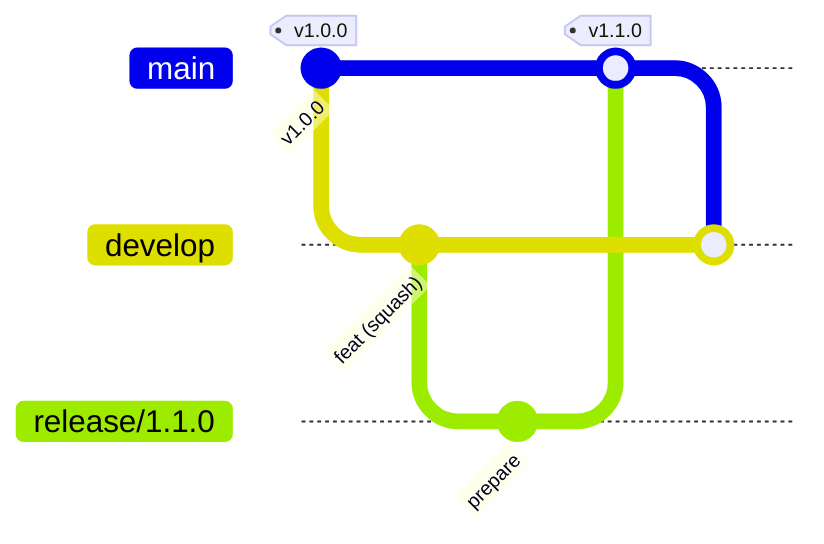

# github-workflows

Reusable GitHub Actions workflows for [gitflow](https://nvie.com/posts/a-successful-git-branching-model/): `develop` is the next release, `main` is the latest release, and releases and hotfixes reach `main` on their own branches.

They only branch, tag and merge back. What a release *does* (publish a package, deploy a docs site, push an image) belongs in your own repository, in workflows that run on the tag:



| Workflow | Runs | Does |
| --- | --- | --- |
| [`gitflow-release.yml`](.github/workflows/gitflow-release.yml) | by hand | Cuts `release/<version>` from `develop` (or `hotfix/<version>` from `main`), runs your prepare command, pushes it and opens its pull request into `main`. |
| [`gitflow-tag.yml`](.github/workflows/gitflow-tag.yml) | on a push to `main` | Pushes `v<version>` if that version is not tagged yet. Nothing else. |
| [`gitflow-merge-back.yml`](.github/workflows/gitflow-merge-back.yml) | on a push to `main` | Opens a pull request from `main` into `develop` and merges it with a merge commit. On a conflict, leaves it open with the steps to resolve it, and fails. |

## Using them

Three short workflows in your repository. Pin `@v1`, which moves with every compatible release.

`.github/workflows/release.yml`, run from **Actions > release > Run workflow**:

```yaml
name: release
on:
  workflow_dispatch:
    inputs:
      version:
        description: "patch, minor, major, or the new version"
        required: true
        default: minor
      kind:
        type: choice
        options: [release, hotfix]
        default: release
concurrency:
  group: release
jobs:
  release:
    uses: zmnatz/github-workflows/.github/workflows/gitflow-release.yml@v1
    with:
      version: ${{ inputs.version }}
      kind: ${{ inputs.kind }}
      # Optional. Bumps the version (and changelog, docs...) and prints the new version last.
      prepare-command: npm version "$HOW" --no-git-tag-version | tr -d v
    secrets:
      RELEASE_TOKEN: ${{ secrets.RELEASE_TOKEN }}
```

`.github/workflows/tag.yml`:

```yaml
name: tag
on:
  push:
    branches: [main]
concurrency:
  group: tag
jobs:
  tag:
    uses: zmnatz/github-workflows/.github/workflows/gitflow-tag.yml@v1
    with:
      version-command: jq -r .version package.json
    secrets:
      RELEASE_TOKEN: ${{ secrets.RELEASE_TOKEN }}
```

`.github/workflows/merge-back.yml`:

```yaml
name: merge-back
on:
  push:
    branches: [main]
  workflow_dispatch: # to retry
concurrency:
  group: merge-back
jobs:
  merge-back:
    uses: zmnatz/github-workflows/.github/workflows/gitflow-merge-back.yml@v1
    with:
      version-command: jq -r .version package.json # optional, for the pull request's title
    secrets:
      RELEASE_TOKEN: ${{ secrets.RELEASE_TOKEN }}
```

Then release on the tag, in your own workflows:

```yaml
on:
  push:
    tags: ["v*"]
```

### Inputs

`gitflow-release.yml`:

| Input | Default | |
| --- | --- | --- |
| `version` | (required) | `patch`, `minor`, `major`, or the new version. |
| `kind` | `release` | `release`, cut from `develop`, or `hotfix`, cut from `main` and opened as a draft. |
| `prepare-command` | | Run on the new branch with `HOW` (the `version` input) and `KIND` set. Changes the working tree as it likes, and prints the new version as its last line. Without one, the version is the latest `v*` tag bumped by `HOW`, and nothing is committed (a hotfix branch is then pushed with no pull request, for you to add the fix to). |
| `notes-command` | | Run with `VERSION` set. Its output goes in the pull request's description, such as the changelog section. |
| `develop-branch`, `main-branch` | `develop`, `main` | |
| `tag-prefix` | `v` | |

`gitflow-tag.yml`: `version-command` (required: prints the version on `main`), `tag-prefix` (`v`), `tag-message` (`"Release "`, followed by the version), `main-branch`. Output: `tag`, empty when nothing was tagged.

`gitflow-merge-back.yml`: `version-command` (optional), `develop-branch`, `main-branch`.

## The token

All three need a `RELEASE_TOKEN` secret, and fail at once without it. GitHub starts no workflows for what a workflow's own token does: a release pull request opened with it gets no checks, and a tag pushed with it releases nothing.

Create a [fine-grained token](https://github.com/settings/personal-access-tokens/new) for the repositories that use these workflows, with **Contents** and **Pull requests: Read and write**, and save it in each as the Actions secret `RELEASE_TOKEN` (**Settings > Secrets and variables > Actions**). When it expires, renew it and update the secrets. The branches, pull requests and tags then show as made by the token's owner.

## Setting up a repository

1. Create `develop` from `main`, and make it the default branch.
2. Rulesets (**Settings > Rules > Rulesets**), each targeting its branch by name, not "Default":
   - `main`: require a pull request; allow **merge commits only**; no "Require linear history". A squash into `main` gives it commits `develop` never has, and every later release conflicts with them.
   - `develop`: require a pull request; allow **squash** and **merge** (merge-backs are merge commits); no "Require linear history".
3. Add the `RELEASE_TOKEN` secret.
4. Anything deployed from a tag through an environment (GitHub Pages' `github-pages`, a package registry's) must allow `v*` tags in that environment's deployment rules.

## Releasing these workflows

Changes merge into `main`. A release is a `v1.x.y` tag, and the `v1` tag moves to it: `git tag -f v1 && git push -f origin v1`. A change that breaks callers is `v2`.

## License

[MIT](LICENSE)
